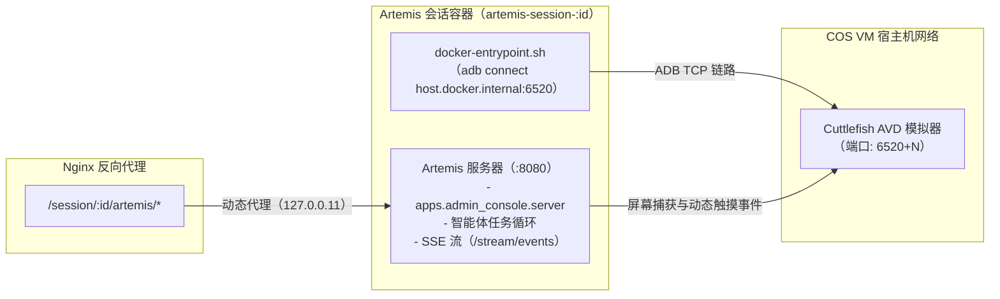

# 🤖 Artemis 会话容器

专用的会话隔离容器镜像，用于在 Google Cloud **Container-Optimized OS（COS）** 上运行 Artemis 自主 AI 智能体。

---

## 📌 架构与生命周期

当用户通过 [Backend Manager](../backend_manager/README.md) 发起会话时，后端会在共享的 `artemis-net` 桥接网络上动态创建一个名为 `artemis-session-<session_id>` 的容器实例。



---

## 🔑 核心特性

1. **自动化 ADB 桥接**：
   - 容器入口脚本（[docker-entrypoint.sh](docker-entrypoint.sh)）会根据 `$ADB_DEVICE_SERIAL`（例如 `host.docker.internal:6520`）自动连接目标 Cuttlefish 实例，并带自动重试处理。

2. **多模态感知与工具链**：
   - 内置 Android Platform Tools（`adb`）、`ffmpeg`、OpenCV 库（`libgl1`、`libglib2.0-0`）和 Python 3.12。

3. **实时事件流**：
   - 托管 Artemis 管理控制台服务器，暴露 SSE 和 WebSocket 端点（`/stream/events`），将智能体推理、思考步骤和动作执行实时推送到前端。

4. **动态选择器与坐标兜底引擎**：
   - 利用 Artemis 的多模态推理流水线，在连接的 Cuttlefish 模拟器上驱动实时自动化导航。

---

## 📁 目录结构

```
playground/artemis_container/
├── Dockerfile                   # Python 3.12 slim，含 adb、ffmpeg、OpenCV 和 Artemis
├── docker-entrypoint.sh         # 自动 ADB 连接循环与服务启动
├── docker-compose.yml           # 用于单独测试会话的 Compose 配置
├── .dockerignore
└── README.md                    # 文档与运维指南
```

---

## ⚙️ 环境变量

| 变量 | 默认值 | 说明 |
| :--- | :--- | :--- |
| `SESSION_ID` | `standalone-dev` | 由 Backend Manager 传入的唯一会话 UUID |
| `ADB_DEVICE_SERIAL` | `host.docker.internal:6520` | 目标 Cuttlefish 模拟器的 TCP 主机和端口 |
| `PORT` | `8080` | Artemis 管理与流服务器端口 |
| `PYTHONUNBUFFERED` | `1` | 确保 stdout 日志即时输出 |
| `GEMINI_API_KEY` | - | 用于智能体推理的 Google Gemini API 密钥 |
| `OPENAI_API_KEY` | - | 可选的 OpenAI API 密钥 |

---

## 🚀 构建与运行

### 1. 构建 Artemis 容器镜像
在仓库根目录执行：
```bash
docker build -f playground/artemis_container/Dockerfile -t artemis:latest .
```

### 2. 使用 Docker CLI 单独运行
```bash
# 确保桥接网络存在
docker network create artemis-net || true

# 运行 Artemis 会话容器，目标为 6520 端口上的 Cuttlefish
docker run -d \
  --name artemis-session-sample \
  --network artemis-net \
  --add-host host.docker.internal:host-gateway \
  -e SESSION_ID=sample-123 \
  -e ADB_DEVICE_SERIAL=host.docker.internal:6520 \
  -e GEMINI_API_KEY="your-gemini-key" \
  -p 8080:8080 \
  artemis:latest
```

### 3. 使用 Docker Compose 运行（测试环境）
```bash
cd playground/artemis_container
docker-compose up -d
```

---

## 🧪 验证与健康检查

1. **验证容器内 ADB 连接**：
   ```bash
   docker exec -it artemis-session-sample adb devices
   ```

2. **验证服务器健康探针**：
   ```bash
   curl http://localhost:8080/api/system/health
   # 返回：{"status": "ok", ...}
   ```

3. **验证追踪流**：
   ```bash
   curl -N http://localhost:8080/stream/events
   # 实时 Server-Sent Events 流
   ```
